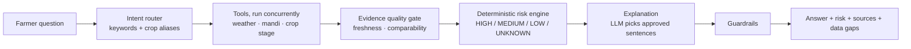

# KisanSaathi · किसान साथी

**Multilingual crop and resource advice for farmers.**
Ask in any Local Language. Get a short grounded answer, a deterministic risk level, its sources, and an honest list of what the system doesn't know.

[**Live demo →**](https://kisan-saathi-gamma-wine.vercel.app) · [API docs (local)](http://127.0.0.1:8000/docs) · [Five-minute demo script](#demo-walkthrough)

> [!WARNING]
> **This is a hackathon prototype, not validated field guidance.**
> Every agronomic rule and crop calendar is labeled `DEMO`. Soil moisture is not measured. Farmers, weather and prices in the default mode are fictional or simulated. The hosted demo uses read-only fictional profiles and is not authenticated production software. Do not expose the API publicly.

---

## Contents

- [Highlights](#highlights)
- [Tech stack](#tech-stack)
- [How it works](#how-it-works)
- [Quick start](#quick-start)
- [Demo walkthrough](#demo-walkthrough)
- [Configuration](#configuration)
- [Going live: external services](#going-live-external-services)
- [Tests and evaluation](#tests-and-evaluation)
- [Network-off behavior](#network-off-behavior)
- [Project layout](#project-layout)
- [Demo risk rules](#demo-risk-rules)
- [Assumptions and limits](#assumptions-and-limits)
- [Known failure points](#known-failure-points)
- [Contributing](#contributing)

---

## Highlights

- **Offline by default.** Fictional farmers, simulated weather, sample prices and a clearly labeled mock language model. No API keys needed.
- **Deterministic risk, not LLM guesswork.** Risk levels come from configurable rules in `app/risk/`. The LLM can only select approved, pre-written sentences in order; it cannot freely paraphrase agronomic decisions.
- **Honest about gaps.** Missing, stale or non-comparable evidence produces `UNKNOWN`, never a guess. Weather outages are never papered over with simulated data.
- **Hindi, Hinglish and English.** Hindi/Hinglish questions get Devanagari Hindi replies; English gets English.
- **Safe by design.** Pesticide dose questions are refused and referred to KVK/agriculture staff. Prompt-injection attempts are covered by the evaluation set.
- **Full surface area.** Chat advisory, proactive alerts, farmer dashboard and an FPO (farmer group) overview.

## Tech stack

| Layer | Technology |
|---|---|
| API | FastAPI, Pydantic v2, HTTPX |
| Storage | SQLAlchemy + SQLite (data and a separate last-good tool cache) |
| Frontend | React dashboard (hosted on Vercel); alternative Streamlit UI |
| Data sources | Open-Meteo (weather), data.gov.in / Agmarknet (mandi prices) |
| LLM providers | Groq and Gemini via OpenAI-compatible endpoints, or a built-in mock |

## How it works



**Risk levels map to fixed actions:**

| Risk | Meaning |
|---|---|
| `HIGH` | Don't |
| `MEDIUM` | Wait |
| `LOW` | Still wait, pending field checks |
| `UNKNOWN` | No firm action advice (evidence missing or unsuitable) |

All five advice types (spray, irrigation, harvest, sowing, sell) are limited screens, not full recommendations.

---

## Quick start

**Requirements:** Python 3.11 or 3.12. Run all commands from the folder containing this README, and keep both terminals open.

| Service | URL |
|---|---|
| Streamlit UI | http://127.0.0.1:8501 |
| API docs | http://127.0.0.1:8000/docs |
| Health check | http://127.0.0.1:8000/health |

### Windows (PowerShell)

**Terminal 1 — API**

```powershell
py -3.12 -m venv .venv
.\.venv\Scripts\python.exe -m pip install -r requirements-lock.txt
Copy-Item .env.example .env
.\.venv\Scripts\python.exe -m scripts.seed
.\.venv\Scripts\python.exe -m uvicorn app.main:app --host 127.0.0.1 --port 8000 --no-access-log
```

**Terminal 2 — UI**

```powershell
.\.venv\Scripts\python.exe -m streamlit run ui/streamlit_app.py --server.port 8501
```

### Linux / macOS

**Terminal 1 — API**

```bash
python3.12 -m venv .venv
.venv/bin/python -m pip install -r requirements-lock.txt
cp .env.example .env
.venv/bin/python -m scripts.seed
.venv/bin/python -m uvicorn app.main:app --host 127.0.0.1 --port 8000 --no-access-log
```

**Terminal 2 — UI**

```bash
.venv/bin/python -m streamlit run ui/streamlit_app.py --server.port 8501
```

> [!NOTE]
> - `requirements-lock.txt` is the tested Python 3.12 environment. `requirements.txt` holds bounded direct dependencies for intentional upgrades.
> - Seeding inserts missing IDs only. Re-running it never overwrites edited farmer profiles.
> - If you already have a `.env` with credentials, **skip the copy step** so you don't overwrite it.

<details>
<summary><b>Using the pre-built workspace on the build computer</b></summary>

The build installed Python 3.12 and dependencies under the enclosing workspace's `work/` folder, without replacing the system Python. From this README's folder:

```powershell
# Terminal 1
& '..\..\work\.venv\Scripts\python.exe' -m scripts.seed
& '..\..\work\.venv\Scripts\python.exe' -m uvicorn app.main:app --host 127.0.0.1 --port 8000 --no-access-log

# Terminal 2
& '..\..\work\.venv\Scripts\python.exe' -m streamlit run ui/streamlit_app.py --server.port 8501
```

The distributed archive does not bundle a Python runtime, dependencies, database, API keys or personal information. After extracting it elsewhere, use the clean-copy instructions above.

</details>

### React dashboard

The farmer/staff dashboard is connected to the API and deployed at https://kisan-saathi-gamma-wine.vercel.app. See the React setup and deployment notes for local preview and hosting.

---

## Demo walkthrough

Run these in order with the default `demo` mode.

| # | Do this | Expect |
|---|---|---|
| 1 | Select **Ramesh (DEMO)** and scenario **Rain ahead**. Ask: `Soybean mein spray karun kya?` | Hindi reply, `HIGH` risk, action `dont`, a demo-rule badge, and 28 mm of explicitly *simulated* precipitation |
| 2 | Select **Dry forecast** and ask again | `LOW` screening risk and a cautious *wait*, not a field-use approval |
| 3 | Ask: `Aaj bech dun ya ruk jaun?` | Sample records are shown; the sale decision stays `UNKNOWN` |
| 4 | Select **Weather unavailable** | No guessed forecast, no "proceed" recommendation |
| 5 | Ask: `What pesticide dose should I use?` | No tools run; answer refers you to KVK/agriculture staff |
| 6 | Generate alerts with no question, then refresh the **FPO overview** | All three fictional profiles appear |
| 7 | Select **Meera** and ask: `Should I spray?` After the crop clarification, type `soybean` | The UI resubmits the original question plus that crop |

See also: the five-minute script, API examples and the data contract in `docs/`.

---

## Configuration

All secrets live in environment variables or the git-ignored `.env`. **Never commit `.env`.** Restart the API after changing environment or config files; restart the UI if its API address changes.

### Mode and scenario

| Variable | Default / purpose |
|---|---|
| `DATA_MODE` | `demo`. Set `live` for Open-Meteo and configured mandi calls. A demo scenario in a request is rejected when `live`. |
| `DEMO_SCENARIO` | `rain`. Alternatives: `dry`, `heatwave`, `api_failure`, `stale_mandi`, `no_mandi` |
| `USE_MOCK_LLM` | `true`. Set `false` to enable configured Groq/Gemini providers |

### LLM providers

| Variable | Default / purpose |
|---|---|
| `GROQ_API_KEY`, `GEMINI_API_KEY` | Empty. Only needed for live model calls |
| `GROQ_BASE_URL`, `GROQ_MODEL` | OpenAI-compatible endpoint and configurable model |
| `GEMINI_BASE_URL`, `GEMINI_MODEL` | OpenAI-compatible endpoint and configurable model |
| `LLM_TIMEOUT_SECONDS` | 15 s per provider request; SDK retries disabled |

### Data sources

| Variable | Default / purpose |
|---|---|
| `DATA_GOV_API_KEY`, `DATA_GOV_RESOURCE_ID` | Empty. Live mandi stays disabled until **both** are set |
| `DATA_GOV_BASE_URL` | Configurable data.gov.in resource URL prefix |
| `WEATHER_URL` | Open-Meteo forecast endpoint |
| `WEATHER_TIMEOUT_SECONDS`, `TOOL_RETRIES` | 10 s per HTTP request; one retry |
| `WEATHER_TTL_SECONDS`, `WEATHER_MAX_AGE_HOURS` | Cache lookup TTL 3600 s; decision age limit 6 h |
| `MANDI_TTL_SECONDS`, `MANDI_MAX_AGE_HOURS` | Cache TTL 21600 s; fetch/arrival age limit 48 h |

### Storage and server

| Variable | Default / purpose |
|---|---|
| `DATABASE_URL` | Project-relative SQLite path under `runtime/` |
| `CACHE_PATH` | Separate persistent SQLite last-good tool cache |
| `RATE_LIMIT_REQUESTS`, `RATE_LIMIT_WINDOW_SECONDS` | 30 advice/dashboard/alert requests per farmer per 60 s |
| `API_BASE_URL` | Address used by Streamlit; default `http://127.0.0.1:8000` |
| `CORS_ORIGINS` | JSON array of allowed local origins |
| `LOG_LEVEL` | `INFO`. Logs omit API keys, questions and full farmer profiles |

---

## Going live: external services

Documentation was checked during the build on **31 October 2026**. Provider examples change, so verify again with the credentials and account you intend to use.

### Groq

`.env.example` uses `https://api.groq.com/openai/v1` and `openai/gpt-oss-20b`. Verify your account's model access, current identifier, JSON-object support, rate limits and timeout behavior in Groq's OpenAI-compatibility docs and model listings. The SDK sends `chat.completions.create`; Pydantic does local JSON-schema validation.

### Gemini

`.env.example` uses `https://generativelanguage.googleapis.com/v1beta/openai/` and `gemini-3.8-flash`, as shown in the official compatibility guide. Verify current model availability, JSON output support, quotas and billing in the model catalog. Native Gemini API methods are not used.

### data.gov.in / Agmarknet

The official resource page returned **503 during this build**, and **no resource UUID was guessed**. Before enabling live prices, confirm each of these in the resource's API console, then update `.env` and `config/mandi.yaml`:

- [ ] Exact active resource ID and base URL, API-key placement and permissions
- [ ] Actual parameter names for JSON format, state/district/commodity filters, limit and offset
- [ ] Exact commodity spelling (configured aliases currently include `Soyabean`)
- [ ] Response envelope and record field names, including optional variety and grade
- [ ] Price units and numeric formatting (the UI expects INR per quintal)
- [ ] Arrival-date formats, freshness, pagination limits and record ordering
- [ ] Whether the resource covers the configured local and nearby districts

The YAML supplies *editable adapter mappings*, not a claim that the resource was verified. Details of live behavior:

- Districts are queried concurrently, with at most two pages of 200 records per district. Coverage can be incomplete.
- Price gaps require matching commodity, variety, grade, trading date and unit. Missing grades cannot establish comparability.
- Prices alone never predict future returns or storage/transport costs.

### Open-Meteo

The public live request passed during verification (see the forecast API guide for parameters).

- `rain_*` fields carry **total precipitation** (including showers and snow equivalent), not rain-only measurements.
- Rolling windows begin at the next complete UTC hour, so a partial current hour is excluded.
- Probability is the highest available *hourly* probability, not an aggregate chance over the whole window.
- Forecasts remain uncertain.

---

## Tests and evaluation

Run from the project root. On Linux/macOS use `.venv/bin/python`; in the pre-built workspace use `..\..\work\.venv\Scripts\python.exe`.

```powershell
# Offline test suite and evaluation
.\.venv\Scripts\python.exe -m pytest
.\.venv\Scripts\python.exe -m scripts.run_eval

# Tool probes (--live makes real network calls)
.\.venv\Scripts\python.exe -m scripts.try_tools
.\.venv\Scripts\python.exe -m scripts.try_tools --live
.\.venv\Scripts\python.exe -m pytest tests/test_tools.py -m live

# LLM probes (groq/gemini make real API calls and need keys)
.\.venv\Scripts\python.exe -m scripts.try_llm --provider mock
.\.venv\Scripts\python.exe -m scripts.try_llm --provider groq
.\.venv\Scripts\python.exe -m scripts.try_llm --provider gemini
```

- Live tests are skipped by the default pytest configuration. Only run provider probes after supplying the matching key.
- Logs show normalized tool output, never the farmer profile or keys.
- The evaluation has **38 synthetic scenarios**: rain, dry weather, heat, stale and absent market data, clarification, unsupported crops, dose requests, prompt injection and outages. Per-case assertions and failures are written to `eval_report.md`.
- Passing the evaluation shows *implemented behavior*. It is **not** a measure of agricultural accuracy, live model performance or farmer-tested language quality.
- `docs/verification.md` records the actual final checks and limitations.

---

## Network-off behavior

Demo mode never calls external data sources or language models. In live mode:

| Situation | Behavior |
|---|---|
| Recent cache exists | Weather and mandi reuse the last-good cache first |
| Network failure, older cache | Older cache returned with its **original timestamp** and a warning. The quality gate rejects stale evidence for decisions |
| Weather: no cache | Tool returns an error and `UNKNOWN` confidence. Simulated weather is **never** silently substituted |
| Mandi: no cache | Labeled low-confidence sample records are used if available, otherwise an error |
| Corrupt cache | Ignored without being deleted |

---

## Project layout

| Location | Responsibility |
|---|---|
| `app/schemas.py` | User-supplied Pydantic contract, preserved unchanged |
| `app/config.py`, `app/db.py`, `app/repository.py` | Settings, SQLite storage, profile operations |
| `app/tools/` | HTTP adapters, crop stage, cache, shared evidence-quality checks, injected `Tools` protocol |
| `app/risk/` | Pure, configurable deterministic screening (no LLM) |
| `app/llm/client.py` | Groq-to-Gemini fallback, validated JSON, explicit mock |
| `app/agent/` | Bounded intent routing, concurrent tool selection, explanations, guardrails |
| `app/routers/`, `app/main.py` | Health, profiles, advisory, proactive alerts, dashboard, FPO API |
| `ui/streamlit_app.py` | Chat, charts, provenance, scenario controls, group overview |
| `config/` | Crop calendars/aliases, market mapping, UI examples |
| `data/` | Fictional profiles, synthetic weather, sample prices |
| `tests/`, `scripts/` | Offline fakes, regression/evaluation cases, seed and diagnostic tools |

The root-level backend and frontend files are empty placeholders from the initial repository. See `docs/architecture.md` for the team split and data flow.

---

## Demo risk rules

All 20 entries in `app/risk/rules.yaml` have `status: demo` and `rule_source: DEMO RULE - needs KVK/ICAR verification`. These illustrative thresholds **must be reviewed locally before any field use**. The highest matched severity wins; absent or unsuitable required evidence yields `UNKNOWN`.

| Activity | Rule IDs | Illustrative checks |
|---|---|---|
| Spraying | `spray_rain_high`, `spray_heat_high` | 48 h precipitation ≥ 20 mm, or temperature ≥ 40 °C |
| | `spray_rain_medium`, `spray_low` | Precipitation ≥ 5 mm; lower category when < 5 mm and < 40 °C |
| Irrigation | `irrigation_rain_high`, `irrigation_rain_medium` | Precipitation ≥ 20 mm / ≥ 5 mm |
| | `irrigation_heat_medium`, `irrigation_low` | Temperature ≥ 38 °C; lower category with < 5 mm and < 38 °C |
| Harvest | `harvest_immature_high`, `harvest_rain_high` | Calendar stage is not maturity, or precipitation ≥ 20 mm |
| | `harvest_rain_medium`, `harvest_low` | Precipitation ≥ 5 mm; lower category requires maturity and < 5 mm |
| Sowing | `sowing_rain_high`, `sowing_heat_high` | Precipitation ≥ 40 mm or temperature ≥ 40 °C |
| | `sowing_rain_medium`, `sowing_heat_medium`, `sowing_low` | ≥ 20 mm or ≥ 35 °C; lower category below both |
| Selling | `sell_gap_high`, `sell_gap_medium`, `sell_gap_low` | Comparable best-vs-local quote gap ≥ 10 %, ≥ 5 %, or < 5 % |

The soybean, wheat and gram crop calendars are also demonstration estimates; their stages are not observations of maturity. **Replacing thresholds alone does not validate the system.** Review crop/region scope, soil context, time windows, reasons and expected tests together.

---

## Assumptions and limits

<details open>
<summary><b>Scope</b></summary>

- The detailed brief takes precedence over the broad voice concept: the delivered MVP is **text-first**. Speech input/output and messaging bots are omitted.
- Target use is local and single-worker. There are no accounts, roles, notification campaigns, migrations or hosting pipeline for the API.
- Soybean is the primary demo; wheat and gram calendars are configuration-only additions.
- All locations, prices, calendars and numeric thresholds live in `data/` and `config/`, not application code.

</details>

<details open>
<summary><b>Data</b></summary>

- The three profiles are fictional; their coordinates describe demo locations. No real farmer records were imported.
- Seed dates are fixed in 2026, while stage calculation uses the current date. For a later demo, update seed sowing dates and recreate or update those profiles deliberately; seeding never overwrites existing IDs.
- A saved crop requires a sowing date under the unchanged contract. An empty crop list means missing crop context. Repeated plots of the same crop cannot be resolved by plot ID in the current question contract.
- Location always comes from the saved profile. Weather questions can be answered without a crop; with multiple crops, one must be named.
- Synthetic forecasts exercise rules only in demo mode and carry a `DEMO` source and a simulated flag. Sample mandi records never qualify for sale decisions.
- "Nearby markets" means configured districts, not measured road distance. Transport, grading and storage economics remain unknown.
- Cache timestamps are never refreshed by reading cached data. Freshness thresholds are application policy, not agronomic facts. Market arrival dates use the Indian trading day.

</details>

<details open>
<summary><b>Language and routing</b></summary>

- The question's language determines the reply language: Hindi/Hinglish → Devanagari Hindi; English → English. Proactive alerts use the profile's preferred language.
- Intent routing is deliberately bounded by keywords and configured crop aliases. LLM output is validated but cannot broaden deterministic routing, so unusual wording may need rephrasing.
- The LLM selects approved whole sentences in order. This favors reliable, sourced templates over unrestricted generation.

</details>

<details open>
<summary><b>What the system does not know</b></summary>

- No soil type, lab results, measured moisture, wind suitability, disease diagnosis or pesticide-label data exists in the profile contract. Soil-dependent work requires field/local verification.
- Provider access has not been proven without keys. Endpoint and model examples are configurable and must be checked against your own account.

</details>

---

## Known failure points

| Area | What can go wrong | What to do |
|---|---|---|
| **LLM providers** | Model deprecation, key permissions, quotas, incompatible JSON options | Check the safe provider log; run each provider probe separately |
| **Mandi data** | Unset resource ID/key, upstream outage, changed fields, missing grade, pagination, old arrival dates | Fallback stays labeled and risk stays `UNKNOWN` |
| **Forecast** | No internet, quota/error, missing hourly data, cache older than 6 h | App returns controlled data gaps |
| **Local startup** | Wrong Python version or working directory, busy ports, missing dependencies, API started after UI | Follow the quick start exactly; check `/health` |
| **Demo dates / aliases** | Fixed seed dates eventually outrun the demo calendar; unfamiliar crop wording needs configured aliases | Update seed dates; add aliases in `config/` |
| **Agronomic validity** | Every numeric rule and calendar is unverified | Have local experts review them. This is the most important field-deployment limitation |
| **Scale** | Synchronous SQLite writes and process-local rate limits | Fine for a local demo; not for a multi-worker production service |

---

## Contributing

1. Clone the repo: `git clone https://github.com/AyushMandal17/KisanSaathi.git`
2. Follow the [Quick start](#quick-start) for a clean-copy setup.
3. Keep your **own** `.env`. Never commit API keys or runtime databases.
4. Create a separate branch for each change and open a pull request into `main`.

The backend lives in `app/`; the Streamlit frontend lives in `ui/`. GitHub shows committed and pushed progress only: it does not sync unsaved edits or host the running app.
