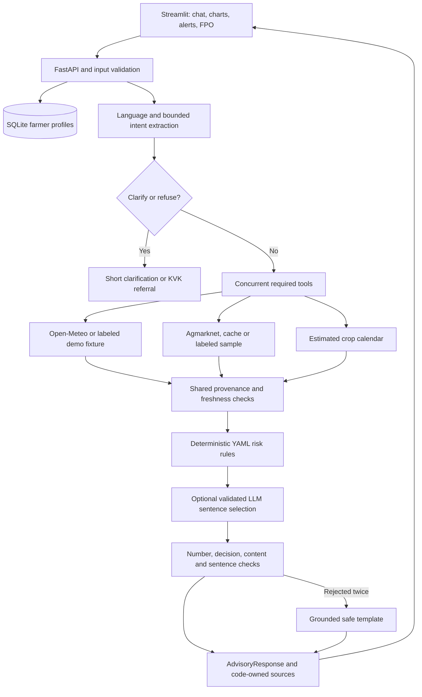

# Architecture and team handoff

The three-builder split was foundation/API/UI/integration, data/cache/risk, and LLM/orchestration/guardrails/evaluation. Each boundary uses the supplied Pydantic models. The original schema and contract examples are preserved.

The intent router chooses only required tools. Spray, irrigation and sowing use weather; harvest uses weather and estimated stage; sale/price uses mandi; general weather/stage queries use their corresponding tool. Dashboards fetch the full context. Alerts inspect all saved crops without classifying a question.

The risk engine has no LLM dependency. Evidence-quality checks reject failed, low-confidence, stale, future-dated, timezone-less or sample evidence. Simulated weather is usable only as a declared demo scenario. Required facts must exist, numeric facts must be finite, and the highest matching rule wins. Every demo rule is exposed as such.

LLM requests use the OpenAI SDK against configured compatible endpoints. Invalid JSON is retried once per provider. Connection/timeout, 429 and server errors fall back from Groq to Gemini; persistent failure yields the deterministic explanation. Client logs contain provider names and status codes, never request bodies or keys. `ContextVar` isolates provider attribution across concurrent requests.

Model prose can choose only complete approved template sentences in their original order. It must preserve the action, uncertainty and demo disclosure. This prevents the model from rearranging otherwise valid words into an unsafe instruction. Sources and their ages are always appended by code after prose validation.

The persistent tool cache has its own SQLite database and stores last-good `ToolResult` JSON. Cache reads retain the original `fetched_at`. The profile database stores validated `FarmerProfile` documents. There are no schema migrations in this MVP.

Follow-up work for the team: verify local agronomic rules and scope with KVK/ICAR, obtain and verify the live mandi resource, test real provider accounts and farmer language comprehension, then decide whether to expand the contract with soil/plot information. Do not silently change shared field names or types.
